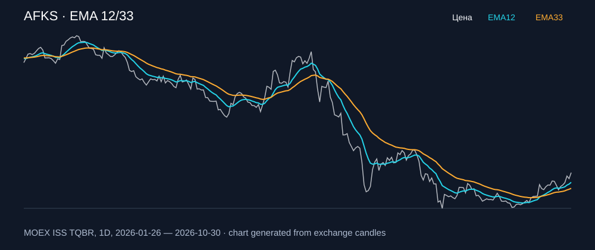

# AFKS — EMA 12/33

[Полный README тикера](../../../../../legacy-ema/12-33-cross/execute/research/tickers/AFKS/README.md) · [TradingView](https://www.tradingview.com/symbols/RUS-AFKS/)

Медианный оборот: **561.9 млн ₽**. Источник цифр ниже: **MOEX ISS + локальный расчёт**, не TradingView.

Критерии: ≥10 закрытых сделок за полный период, ≥3 в 2025–2026 и ≥1 прибыльная поздняя сделка, положительная доходность и превышение удержания на обоих периодах, profit factor >1, просадка не глубже 30%, медианный оборот ≥50 млн ₽.

| Интервал | Режим | EMA | Закрытых сделок | Прибыльных | Доходность | Макс. просадка | Сделок 2025–26 | Доходность 2025–26 | Превышение удержания 2025–26 |
| --- | --- | --- | ---: | ---: | ---: | ---: | ---: | ---: | ---: |
| 1D | long | 12/33 | 15 | 4/15 (26.67%) | 14.34% | -10.39% | 8 | 0.48% | 12.18 п.п. |
| 1D | short | 12/33 | 15 | 5/15 (33.33%) | 18.02% | -6.44% | 9 | 10.55% | 22.24 п.п. |
| 1D | long_short | 12/33 | 30 | 9/30 (30.0%) | 34.96% | -12.73% | 17 | 11.08% | 22.78 п.п. |
| 1H | long | 12/33 | 162 | 53/162 (32.72%) | 18.57% | -9.03% | 116 | 8.64% | 20.34 п.п. |
| 1H | short | 12/33 | 163 | 59/163 (36.2%) | 31.48% | -5.67% | 117 | 21.07% | 32.76 п.п. |
| 1H | long_short | 12/33 | 325 | 112/325 (34.46%) | 55.9% | -7.49% | 233 | 31.54% | 43.23 п.п. |
| 4H | long | 12/33 | 45 | 15/45 (33.33%) | 7.19% | -9.72% | 34 | 0.26% | 11.95 п.п. |
| 4H | short | 12/33 | 46 | 19/46 (41.3%) | 20.48% | -5.84% | 35 | 10.17% | 21.86 п.п. |
| 4H | long_short | 12/33 | 91 | 34/91 (37.36%) | 29.12% | -9.43% | 69 | 10.44% | 22.14 п.п. |

Результаты `short` и `long_short` оптимистичны: плата за заём, дивидендные обязательства и доступность шорта не учтены.

График построен из свечей MOEX, это не скриншот TradingView.
