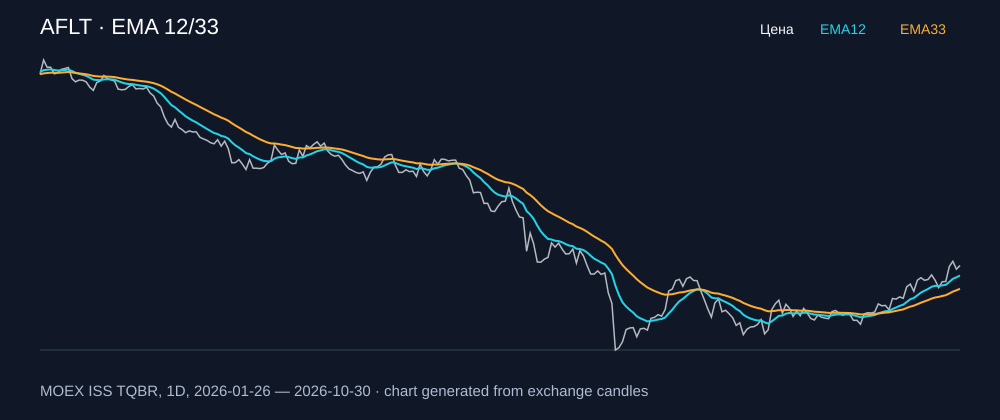

# AFLT — EMA 12/33

[Полный README тикера](../../../../../legacy-ema/12-33-cross/execute/research/tickers/AFLT/README.md) · [TradingView](https://www.tradingview.com/symbols/RUS-AFLT/)

Медианный оборот: **621.2 млн ₽**. Источник цифр ниже: **MOEX ISS + локальный расчёт**, не TradingView.

Критерии: ≥10 закрытых сделок за полный период, ≥3 в 2025–2026 и ≥1 прибыльная поздняя сделка, положительная доходность и превышение удержания на обоих периодах, profit factor >1, просадка не глубже 30%, медианный оборот ≥50 млн ₽.

| Интервал | Режим | EMA | Закрытых сделок | Прибыльных | Доходность | Макс. просадка | Сделок 2025–26 | Доходность 2025–26 | Превышение удержания 2025–26 |
| --- | --- | --- | ---: | ---: | ---: | ---: | ---: | ---: | ---: |
| 1D | short | 12/33 | 12 | 5/12 (41.67%) | 4.87% | -11.91% | 6 | 8.21% | 17.32 п.п. |
| 1D | long_short | 12/33 | 24 | 9/24 (37.5%) | 26.95% | -16.41% | 11 | 5.68% | 14.78 п.п. |
| 4H | short | 12/33 | 49 | 18/49 (36.73%) | 5.31% | -7.19% | 37 | 6.68% | 15.78 п.п. |
| 4H | long_short | 12/33 | 97 | 33/97 (34.02%) | 15.5% | -10.12% | 73 | 4.09% | 13.19 п.п. |

Результаты `short` и `long_short` оптимистичны: плата за заём, дивидендные обязательства и доступность шорта не учтены.

График построен из свечей MOEX, это не скриншот TradingView.
