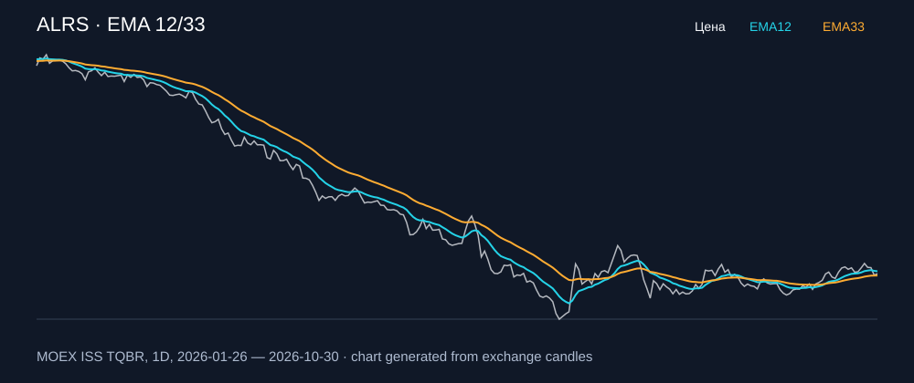

# ALRS — EMA 12/33

[Полный README тикера](../../../../../legacy-ema/12-33-cross/execute/research/tickers/ALRS/README.md) · [TradingView](https://www.tradingview.com/symbols/RUS-ALRS/)

Медианный оборот: **785.3 млн ₽**. Источник цифр ниже: **MOEX ISS + локальный расчёт**, не TradingView.

Критерии: ≥10 закрытых сделок за полный период, ≥3 в 2025–2026 и ≥1 прибыльная поздняя сделка, положительная доходность и превышение удержания на обоих периодах, profit factor >1, просадка не глубже 30%, медианный оборот ≥50 млн ₽.

| Интервал | Режим | EMA | Закрытых сделок | Прибыльных | Доходность | Макс. просадка | Сделок 2025–26 | Доходность 2025–26 | Превышение удержания 2025–26 |
| --- | --- | --- | ---: | ---: | ---: | ---: | ---: | ---: | ---: |
| 1D | short | 12/33 | 17 | 6/17 (35.29%) | 14.7% | -7.27% | 9 | 9.26% | 25.51 п.п. |
| 1H | short | 12/33 | 180 | 66/180 (36.67%) | 32.97% | -4.36% | 135 | 20.06% | 36.31 п.п. |
| 1H | long_short | 12/33 | 360 | 117/360 (32.5%) | 36.33% | -9.79% | 270 | 16.33% | 32.57 п.п. |
| 4H | short | 12/33 | 39 | 19/39 (48.72%) | 28.51% | -5.73% | 29 | 20.63% | 36.87 п.п. |
| 4H | long_short | 12/33 | 78 | 32/78 (41.03%) | 28.61% | -7.88% | 58 | 17.14% | 33.39 п.п. |

Результаты `short` и `long_short` оптимистичны: плата за заём, дивидендные обязательства и доступность шорта не учтены.

График построен из свечей MOEX, это не скриншот TradingView.
