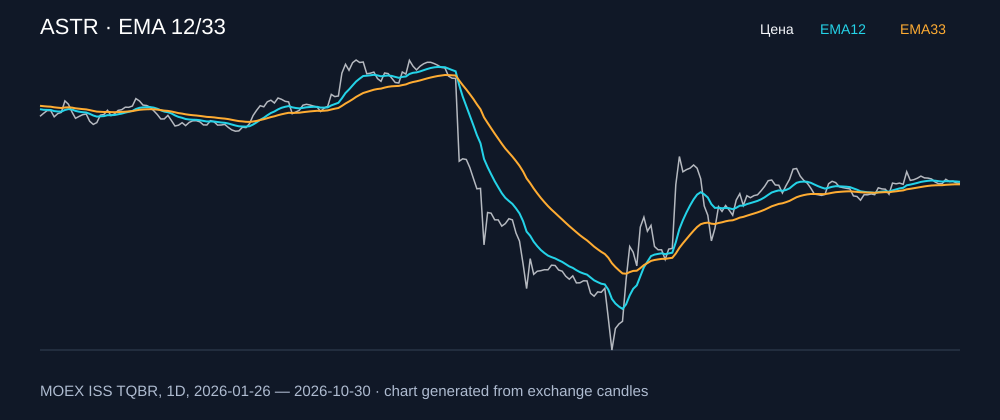

# ASTR — EMA 12/33

[Полный README тикера](../../../../../legacy-ema/12-33-cross/execute/research/tickers/ASTR/README.md) · [TradingView](https://www.tradingview.com/symbols/RUS-ASTR/)

Медианный оборот: **109.1 млн ₽**. Источник цифр ниже: **MOEX ISS + локальный расчёт**, не TradingView.

Критерии: ≥10 закрытых сделок за полный период, ≥3 в 2025–2026 и ≥1 прибыльная поздняя сделка, положительная доходность и превышение удержания на обоих периодах, profit factor >1, просадка не глубже 30%, медианный оборот ≥50 млн ₽.

| Интервал | Режим | EMA | Закрытых сделок | Прибыльных | Доходность | Макс. просадка | Сделок 2025–26 | Доходность 2025–26 | Превышение удержания 2025–26 |
| --- | --- | --- | ---: | ---: | ---: | ---: | ---: | ---: | ---: |
| 1D | long_short | 12/33 | 17 | 7/17 (41.18%) | 14.67% | -7.83% | 12 | 8.26% | 21.77 п.п. |
| 1H | long | 12/33 | 177 | 49/177 (27.68%) | 2.29% | -14.11% | 124 | 0.21% | 13.71 п.п. |
| 1H | short | 12/33 | 177 | 65/177 (36.72%) | 19.55% | -5.05% | 124 | 15.72% | 29.23 п.п. |
| 1H | long_short | 12/33 | 354 | 114/354 (32.2%) | 22.29% | -8.89% | 248 | 15.96% | 29.47 п.п. |
| 4H | short | 12/33 | 60 | 17/60 (28.33%) | 7.87% | -8.81% | 37 | 11.62% | 25.13 п.п. |
| 4H | long_short | 12/33 | 120 | 31/120 (25.83%) | 0.26% | -15.63% | 74 | 6.19% | 19.69 п.п. |

Результаты `short` и `long_short` оптимистичны: плата за заём, дивидендные обязательства и доступность шорта не учтены.

График построен из свечей MOEX, это не скриншот TradingView.
