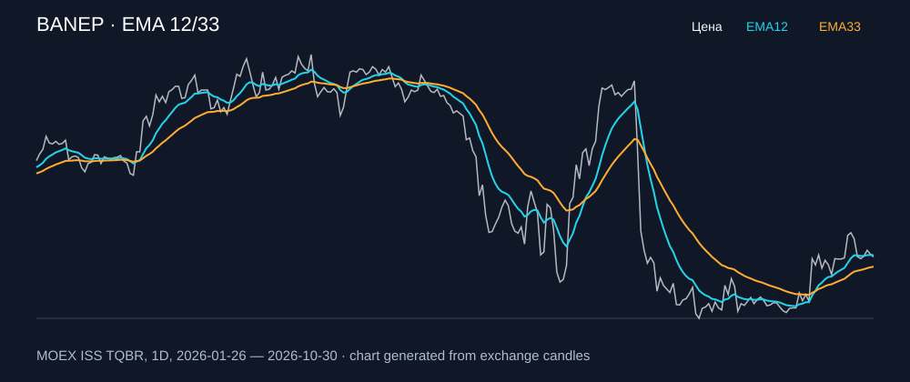

# BANEP — EMA 12/33

[Полный README тикера](../../../../../legacy-ema/12-33-cross/execute/research/tickers/BANEP/README.md) · [TradingView](https://www.tradingview.com/symbols/RUS-BANEP/)

Медианный оборот: **70.4 млн ₽**. Источник цифр ниже: **MOEX ISS + локальный расчёт**, не TradingView.

Критерии: ≥10 закрытых сделок за полный период, ≥3 в 2025–2026 и ≥1 прибыльная поздняя сделка, положительная доходность и превышение удержания на обоих периодах, profit factor >1, просадка не глубже 30%, медианный оборот ≥50 млн ₽.

| Интервал | Режим | EMA | Закрытых сделок | Прибыльных | Доходность | Макс. просадка | Сделок 2025–26 | Доходность 2025–26 | Превышение удержания 2025–26 |
| --- | --- | --- | ---: | ---: | ---: | ---: | ---: | ---: | ---: |
| 1D | short | 12/33 | 16 | 4/16 (25.0%) | 8.9% | -13.25% | 8 | 3.46% | 13.33 п.п. |
| 1H | short | 12/33 | 166 | 56/166 (33.73%) | 13.99% | -6.41% | 125 | 0.99% | 10.86 п.п. |
| 4H | short | 12/33 | 49 | 16/49 (32.65%) | 11.62% | -8.47% | 38 | 0.6% | 10.47 п.п. |

Результаты `short` и `long_short` оптимистичны: плата за заём, дивидендные обязательства и доступность шорта не учтены.

График построен из свечей MOEX, это не скриншот TradingView.
