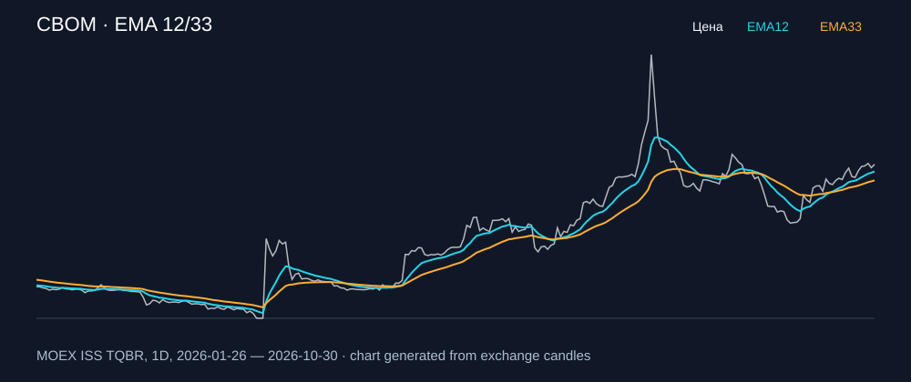

# CBOM — EMA 12/33

[Полный README тикера](../../../../../legacy-ema/12-33-cross/execute/research/tickers/CBOM/README.md) · [TradingView](https://www.tradingview.com/symbols/RUS-CBOM/)

Медианный оборот: **92.2 млн ₽**. Источник цифр ниже: **MOEX ISS + локальный расчёт**, не TradingView.

Критерии: ≥10 закрытых сделок за полный период, ≥3 в 2025–2026 и ≥1 прибыльная поздняя сделка, положительная доходность и превышение удержания на обоих периодах, profit factor >1, просадка не глубже 30%, медианный оборот ≥50 млн ₽.

| Интервал | Режим | EMA | Закрытых сделок | Прибыльных | Доходность | Макс. просадка | Сделок 2025–26 | Доходность 2025–26 | Превышение удержания 2025–26 |
| --- | --- | --- | ---: | ---: | ---: | ---: | ---: | ---: | ---: |
| 1D | long | 12/33 | 16 | 7/16 (43.75%) | 15.66% | -14.12% | 6 | 2.26% | 1.73 п.п. |

График построен из свечей MOEX, это не скриншот TradingView.
