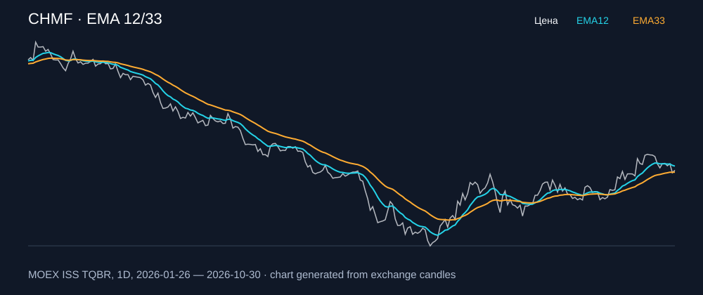

# CHMF — EMA 12/33

[Полный README тикера](../../../../../legacy-ema/12-33-cross/execute/research/tickers/CHMF/README.md) · [TradingView](https://www.tradingview.com/symbols/RUS-CHMF/)

Медианный оборот: **759.8 млн ₽**. Источник цифр ниже: **MOEX ISS + локальный расчёт**, не TradingView.

Критерии: ≥10 закрытых сделок за полный период, ≥3 в 2025–2026 и ≥1 прибыльная поздняя сделка, положительная доходность и превышение удержания на обоих периодах, profit factor >1, просадка не глубже 30%, медианный оборот ≥50 млн ₽.

| Интервал | Режим | EMA | Закрытых сделок | Прибыльных | Доходность | Макс. просадка | Сделок 2025–26 | Доходность 2025–26 | Превышение удержания 2025–26 |
| --- | --- | --- | ---: | ---: | ---: | ---: | ---: | ---: | ---: |
| 1D | short | 12/33 | 16 | 5/16 (31.25%) | 21.66% | -8.74% | 10 | 7.1% | 18.98 п.п. |
| 1D | long_short | 12/33 | 31 | 11/31 (35.48%) | 42.17% | -8.27% | 19 | 3.7% | 15.58 п.п. |
| 1H | short | 12/33 | 180 | 65/180 (36.11%) | 17.68% | -4.6% | 130 | 9.09% | 20.97 п.п. |
| 1H | long_short | 12/33 | 360 | 117/360 (32.5%) | 20.06% | -7.77% | 260 | 5.21% | 17.09 п.п. |
| 4H | short | 12/33 | 54 | 20/54 (37.04%) | 12.92% | -6.58% | 40 | 8.28% | 20.16 п.п. |
| 4H | long_short | 12/33 | 108 | 34/108 (31.48%) | 7.63% | -11.68% | 80 | 3.71% | 15.59 п.п. |

Результаты `short` и `long_short` оптимистичны: плата за заём, дивидендные обязательства и доступность шорта не учтены.

График построен из свечей MOEX, это не скриншот TradingView.
