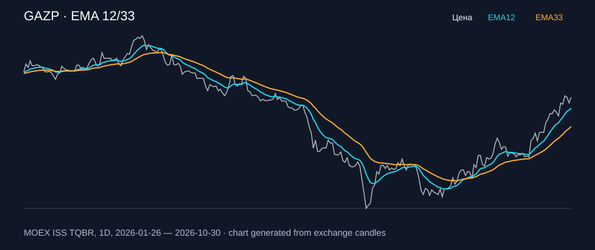

# GAZP — EMA 12/33

[Полный README тикера](../../../../../legacy-ema/12-33-cross/execute/research/tickers/GAZP/README.md) · [TradingView](https://www.tradingview.com/symbols/RUS-GAZP/)

Медианный оборот: **7817.6 млн ₽**. Источник цифр ниже: **MOEX ISS + локальный расчёт**, не TradingView.

Критерии: ≥10 закрытых сделок за полный период, ≥3 в 2025–2026 и ≥1 прибыльная поздняя сделка, положительная доходность и превышение удержания на обоих периодах, profit factor >1, просадка не глубже 30%, медианный оборот ≥50 млн ₽.

| Интервал | Режим | EMA | Закрытых сделок | Прибыльных | Доходность | Макс. просадка | Сделок 2025–26 | Доходность 2025–26 | Превышение удержания 2025–26 |
| --- | --- | --- | ---: | ---: | ---: | ---: | ---: | ---: | ---: |
| 1H | long | 12/33 | 168 | 49/168 (29.17%) | 19.15% | -6.5% | 125 | 10.22% | 13.27 п.п. |
| 1H | short | 12/33 | 169 | 56/169 (33.14%) | 23.66% | -6.0% | 126 | 9.78% | 12.83 п.п. |
| 1H | long_short | 12/33 | 337 | 105/337 (31.16%) | 47.36% | -5.72% | 251 | 21.0% | 24.05 п.п. |
| 4H | short | 12/33 | 51 | 17/51 (33.33%) | 8.83% | -8.33% | 36 | 5.86% | 8.92 п.п. |
| 4H | long_short | 12/33 | 101 | 32/101 (31.68%) | 13.12% | -8.77% | 71 | 13.89% | 16.94 п.п. |

Результаты `short` и `long_short` оптимистичны: плата за заём, дивидендные обязательства и доступность шорта не учтены.

График построен из свечей MOEX, это не скриншот TradingView.
