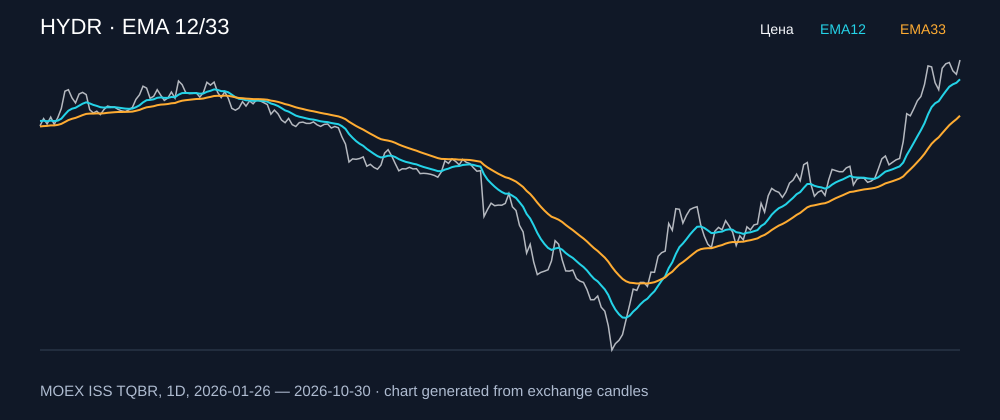

# HYDR — EMA 12/33

[Полный README тикера](../../../../../legacy-ema/12-33-cross/execute/research/tickers/HYDR/README.md) · [TradingView](https://www.tradingview.com/symbols/RUS-HYDR/)

Медианный оборот: **104.3 млн ₽**. Источник цифр ниже: **MOEX ISS + локальный расчёт**, не TradingView.

Критерии: ≥10 закрытых сделок за полный период, ≥3 в 2025–2026 и ≥1 прибыльная поздняя сделка, положительная доходность и превышение удержания на обоих периодах, profit factor >1, просадка не глубже 30%, медианный оборот ≥50 млн ₽.

| Интервал | Режим | EMA | Закрытых сделок | Прибыльных | Доходность | Макс. просадка | Сделок 2025–26 | Доходность 2025–26 | Превышение удержания 2025–26 |
| --- | --- | --- | ---: | ---: | ---: | ---: | ---: | ---: | ---: |
| 1D | short | 12/33 | 14 | 5/14 (35.71%) | 8.88% | -11.66% | 5 | 10.72% | 13.08 п.п. |
| 1D | long_short | 12/33 | 27 | 10/27 (37.04%) | 16.13% | -14.48% | 9 | 23.02% | 25.39 п.п. |

Результаты `short` и `long_short` оптимистичны: плата за заём, дивидендные обязательства и доступность шорта не учтены.

График построен из свечей MOEX, это не скриншот TradingView.
