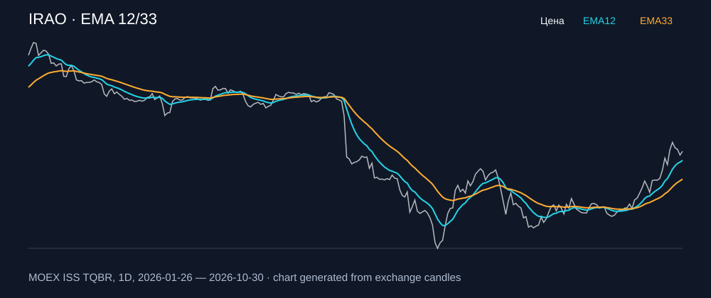

# IRAO — EMA 12/33

[Полный README тикера](../../../../../legacy-ema/12-33-cross/execute/research/tickers/IRAO/README.md) · [TradingView](https://www.tradingview.com/symbols/RUS-IRAO/)

Медианный оборот: **295.6 млн ₽**. Источник цифр ниже: **MOEX ISS + локальный расчёт**, не TradingView.

Критерии: ≥10 закрытых сделок за полный период, ≥3 в 2025–2026 и ≥1 прибыльная поздняя сделка, положительная доходность и превышение удержания на обоих периодах, profit factor >1, просадка не глубже 30%, медианный оборот ≥50 млн ₽.

| Интервал | Режим | EMA | Закрытых сделок | Прибыльных | Доходность | Макс. просадка | Сделок 2025–26 | Доходность 2025–26 | Превышение удержания 2025–26 |
| --- | --- | --- | ---: | ---: | ---: | ---: | ---: | ---: | ---: |
| 4H | long | 12/33 | 46 | 16/46 (34.78%) | 5.6% | -5.7% | 32 | 6.92% | 13.25 п.п. |
| 4H | short | 12/33 | 47 | 19/47 (40.43%) | 12.58% | -4.59% | 33 | 12.05% | 18.38 п.п. |
| 4H | long_short | 12/33 | 93 | 35/93 (37.63%) | 18.89% | -5.58% | 65 | 19.8% | 26.13 п.п. |

Результаты `short` и `long_short` оптимистичны: плата за заём, дивидендные обязательства и доступность шорта не учтены.

График построен из свечей MOEX, это не скриншот TradingView.
