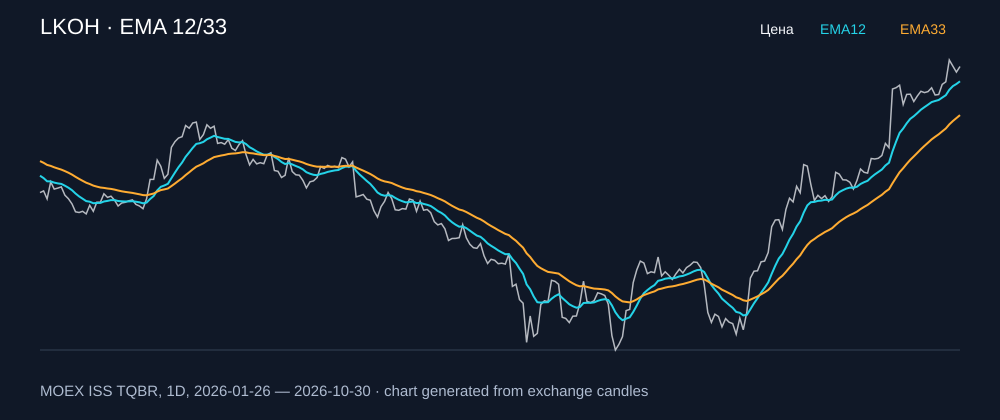

# LKOH — EMA 12/33

[Полный README тикера](../../../../../legacy-ema/12-33-cross/execute/research/tickers/LKOH/README.md) · [TradingView](https://www.tradingview.com/symbols/RUS-LKOH/)

Медианный оборот: **5824.9 млн ₽**. Источник цифр ниже: **MOEX ISS + локальный расчёт**, не TradingView.

Критерии: ≥10 закрытых сделок за полный период, ≥3 в 2025–2026 и ≥1 прибыльная поздняя сделка, положительная доходность и превышение удержания на обоих периодах, profit factor >1, просадка не глубже 30%, медианный оборот ≥50 млн ₽.

| Интервал | Режим | EMA | Закрытых сделок | Прибыльных | Доходность | Макс. просадка | Сделок 2025–26 | Доходность 2025–26 | Превышение удержания 2025–26 |
| --- | --- | --- | ---: | ---: | ---: | ---: | ---: | ---: | ---: |
| 1D | short | 12/33 | 13 | 6/13 (46.15%) | 7.56% | -5.85% | 7 | 1.65% | 4.96 п.п. |
| 1D | long_short | 12/33 | 25 | 10/25 (40.0%) | 26.16% | -9.58% | 13 | 1.71% | 5.02 п.п. |
| 1H | long | 12/33 | 181 | 58/181 (32.04%) | 9.62% | -6.73% | 130 | 6.59% | 9.9 п.п. |
| 1H | short | 12/33 | 181 | 59/181 (32.6%) | 9.01% | -4.44% | 131 | 7.48% | 10.79 п.п. |
| 1H | long_short | 12/33 | 362 | 117/362 (32.32%) | 19.21% | -5.91% | 261 | 14.54% | 17.85 п.п. |
| 4H | short | 12/33 | 56 | 16/56 (28.57%) | 3.52% | -4.18% | 40 | 3.67% | 6.98 п.п. |
| 4H | long_short | 12/33 | 111 | 31/111 (27.93%) | 7.34% | -9.0% | 79 | 6.57% | 9.88 п.п. |

Результаты `short` и `long_short` оптимистичны: плата за заём, дивидендные обязательства и доступность шорта не учтены.

График построен из свечей MOEX, это не скриншот TradingView.

[Присланный скриншот TradingView](../../../../../legacy-ema/12-33-cross/execute/evidence/LKOH_tradingview_2026-10-31.png): 39,05% прибыльных сделок, +265,04% за 1997–2026. Период и источник отличаются от локального теста.
