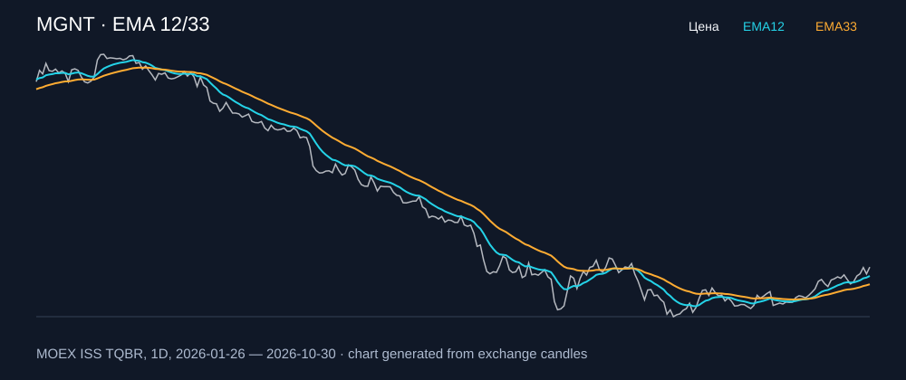

# MGNT — EMA 12/33

[Полный README тикера](../../../../../legacy-ema/12-33-cross/execute/research/tickers/MGNT/README.md) · [TradingView](https://www.tradingview.com/symbols/RUS-MGNT/)

Медианный оборот: **566.2 млн ₽**. Источник цифр ниже: **MOEX ISS + локальный расчёт**, не TradingView.

Критерии: ≥10 закрытых сделок за полный период, ≥3 в 2025–2026 и ≥1 прибыльная поздняя сделка, положительная доходность и превышение удержания на обоих периодах, profit factor >1, просадка не глубже 30%, медианный оборот ≥50 млн ₽.

| Интервал | Режим | EMA | Закрытых сделок | Прибыльных | Доходность | Макс. просадка | Сделок 2025–26 | Доходность 2025–26 | Превышение удержания 2025–26 |
| --- | --- | --- | ---: | ---: | ---: | ---: | ---: | ---: | ---: |
| 1D | short | 12/33 | 17 | 7/17 (41.18%) | 11.53% | -10.91% | 9 | 16.99% | 32.94 п.п. |
| 1D | long_short | 12/33 | 34 | 10/34 (29.41%) | 8.75% | -17.22% | 17 | 14.73% | 30.68 п.п. |
| 1H | short | 12/33 | 178 | 62/178 (34.83%) | 24.93% | -6.18% | 131 | 12.8% | 28.75 п.п. |
| 1H | long_short | 12/33 | 355 | 108/355 (30.42%) | 16.1% | -10.6% | 262 | 2.22% | 18.17 п.п. |
| 4H | short | 12/33 | 49 | 19/49 (38.78%) | 23.57% | -5.89% | 40 | 14.02% | 29.98 п.п. |
| 4H | long_short | 12/33 | 98 | 33/98 (33.67%) | 15.14% | -9.17% | 79 | 5.44% | 21.39 п.п. |

Результаты `short` и `long_short` оптимистичны: плата за заём, дивидендные обязательства и доступность шорта не учтены.

График построен из свечей MOEX, это не скриншот TradingView.
