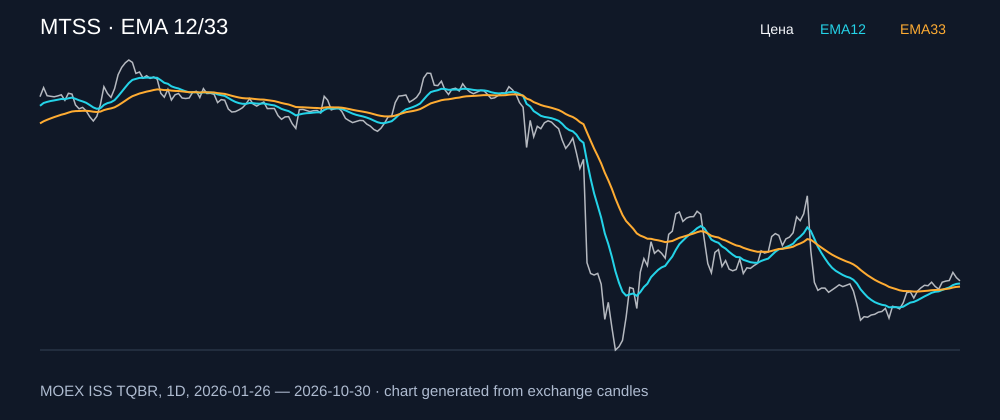

# MTSS — EMA 12/33

[Полный README тикера](../../../../../legacy-ema/12-33-cross/execute/research/tickers/MTSS/README.md) · [TradingView](https://www.tradingview.com/symbols/RUS-MTSS/)

Медианный оборот: **519.9 млн ₽**. Источник цифр ниже: **MOEX ISS + локальный расчёт**, не TradingView.

Критерии: ≥10 закрытых сделок за полный период, ≥3 в 2025–2026 и ≥1 прибыльная поздняя сделка, положительная доходность и превышение удержания на обоих периодах, profit factor >1, просадка не глубже 30%, медианный оборот ≥50 млн ₽.

| Интервал | Режим | EMA | Закрытых сделок | Прибыльных | Доходность | Макс. просадка | Сделок 2025–26 | Доходность 2025–26 | Превышение удержания 2025–26 |
| --- | --- | --- | ---: | ---: | ---: | ---: | ---: | ---: | ---: |
| 4H | long | 12/33 | 48 | 15/48 (31.25%) | 8.57% | -4.63% | 38 | 2.42% | 6.5 п.п. |
| 4H | short | 12/33 | 49 | 15/49 (30.61%) | 16.16% | -5.77% | 39 | 7.12% | 11.19 п.п. |
| 4H | long_short | 12/33 | 97 | 30/97 (30.93%) | 26.14% | -7.33% | 77 | 9.72% | 13.79 п.п. |

Результаты `short` и `long_short` оптимистичны: плата за заём, дивидендные обязательства и доступность шорта не учтены.

График построен из свечей MOEX, это не скриншот TradingView.
