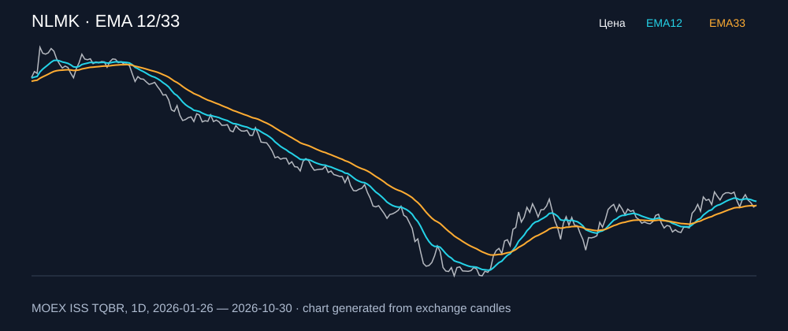

# NLMK — EMA 12/33

[Полный README тикера](../../../../../legacy-ema/12-33-cross/execute/research/tickers/NLMK/README.md) · [TradingView](https://www.tradingview.com/symbols/RUS-NLMK/)

Медианный оборот: **651.4 млн ₽**. Источник цифр ниже: **MOEX ISS + локальный расчёт**, не TradingView.

Критерии: ≥10 закрытых сделок за полный период, ≥3 в 2025–2026 и ≥1 прибыльная поздняя сделка, положительная доходность и превышение удержания на обоих периодах, profit factor >1, просадка не глубже 30%, медианный оборот ≥50 млн ₽.

| Интервал | Режим | EMA | Закрытых сделок | Прибыльных | Доходность | Макс. просадка | Сделок 2025–26 | Доходность 2025–26 | Превышение удержания 2025–26 |
| --- | --- | --- | ---: | ---: | ---: | ---: | ---: | ---: | ---: |
| 1D | short | 12/33 | 14 | 6/14 (42.86%) | 28.43% | -6.93% | 8 | 7.28% | 19.64 п.п. |
| 1D | long_short | 12/33 | 27 | 11/27 (40.74%) | 48.53% | -9.59% | 15 | 1.74% | 14.1 п.п. |
| 1H | short | 12/33 | 170 | 64/170 (37.65%) | 28.83% | -5.27% | 118 | 14.27% | 26.63 п.п. |
| 1H | long_short | 12/33 | 340 | 116/340 (34.12%) | 36.96% | -7.27% | 236 | 14.16% | 26.52 п.п. |
| 4H | short | 12/33 | 47 | 21/47 (44.68%) | 23.42% | -4.86% | 36 | 12.87% | 25.23 п.п. |
| 4H | long_short | 12/33 | 94 | 33/94 (35.11%) | 26.54% | -7.07% | 72 | 12.27% | 24.63 п.п. |

Результаты `short` и `long_short` оптимистичны: плата за заём, дивидендные обязательства и доступность шорта не учтены.

График построен из свечей MOEX, это не скриншот TradingView.
