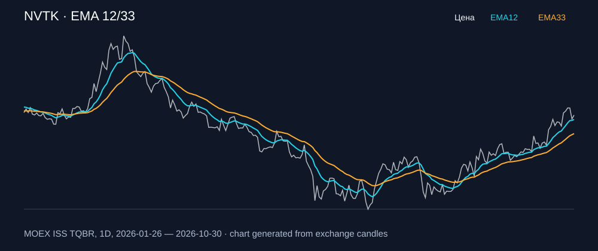

# NVTK — EMA 12/33

[Полный README тикера](../../../../../legacy-ema/12-33-cross/execute/research/tickers/NVTK/README.md) · [TradingView](https://www.tradingview.com/symbols/RUS-NVTK/)

Медианный оборот: **2891.5 млн ₽**. Источник цифр ниже: **MOEX ISS + локальный расчёт**, не TradingView.

Критерии: ≥10 закрытых сделок за полный период, ≥3 в 2025–2026 и ≥1 прибыльная поздняя сделка, положительная доходность и превышение удержания на обоих периодах, profit factor >1, просадка не глубже 30%, медианный оборот ≥50 млн ₽.

| Интервал | Режим | EMA | Закрытых сделок | Прибыльных | Доходность | Макс. просадка | Сделок 2025–26 | Доходность 2025–26 | Превышение удержания 2025–26 |
| --- | --- | --- | ---: | ---: | ---: | ---: | ---: | ---: | ---: |
| 1H | long | 12/33 | 170 | 55/170 (32.35%) | 15.53% | -5.22% | 122 | 12.29% | 8.27 п.п. |
| 1H | long_short | 12/33 | 341 | 114/341 (33.43%) | 35.67% | -6.11% | 245 | 16.81% | 12.79 п.п. |

Результаты `short` и `long_short` оптимистичны: плата за заём, дивидендные обязательства и доступность шорта не учтены.

График построен из свечей MOEX, это не скриншот TradingView.
