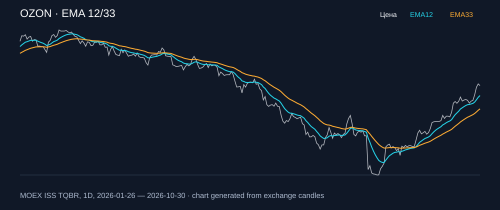

# OZON — EMA 12/33

[Полный README тикера](../../../../../legacy-ema/12-33-cross/execute/research/tickers/OZON/README.md) · [TradingView](https://www.tradingview.com/symbols/RUS-OZON/)

Медианный оборот: **4017.3 млн ₽**. Источник цифр ниже: **MOEX ISS + локальный расчёт**, не TradingView.

Критерии: ≥10 закрытых сделок за полный период, ≥3 в 2025–2026 и ≥1 прибыльная поздняя сделка, положительная доходность и превышение удержания на обоих периодах, profit factor >1, просадка не глубже 30%, медианный оборот ≥50 млн ₽.

| Интервал | Режим | EMA | Закрытых сделок | Прибыльных | Доходность | Макс. просадка | Сделок 2025–26 | Доходность 2025–26 | Превышение удержания 2025–26 |
| --- | --- | --- | ---: | ---: | ---: | ---: | ---: | ---: | ---: |
| 1D | long_short | 12/33 | 26 | 10/26 (38.46%) | 53.21% | -11.74% | 5 | 24.36% | 20.57 п.п. |
| 1H | long | 12/33 | 166 | 49/166 (29.52%) | 21.38% | -10.54% | 121 | 5.5% | 1.72 п.п. |
| 4H | long | 12/33 | 41 | 12/41 (29.27%) | 23.09% | -7.14% | 30 | 7.26% | 3.48 п.п. |
| 4H | long_short | 12/33 | 83 | 27/83 (32.53%) | 33.27% | -12.11% | 61 | 11.27% | 7.49 п.п. |

Результаты `short` и `long_short` оптимистичны: плата за заём, дивидендные обязательства и доступность шорта не учтены.

График построен из свечей MOEX, это не скриншот TradingView.
