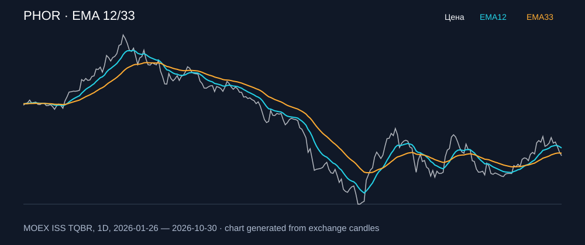

# PHOR — EMA 12/33

[Полный README тикера](../../../../../legacy-ema/12-33-cross/execute/research/tickers/PHOR/README.md) · [TradingView](https://www.tradingview.com/symbols/RUS-PHOR/)

Медианный оборот: **559.9 млн ₽**. Источник цифр ниже: **MOEX ISS + локальный расчёт**, не TradingView.

Критерии: ≥10 закрытых сделок за полный период, ≥3 в 2025–2026 и ≥1 прибыльная поздняя сделка, положительная доходность и превышение удержания на обоих периодах, profit factor >1, просадка не глубже 30%, медианный оборот ≥50 млн ₽.

| Интервал | Режим | EMA | Закрытых сделок | Прибыльных | Доходность | Макс. просадка | Сделок 2025–26 | Доходность 2025–26 | Превышение удержания 2025–26 |
| --- | --- | --- | ---: | ---: | ---: | ---: | ---: | ---: | ---: |
| 4H | long | 12/33 | 50 | 12/50 (24.0%) | 3.0% | -6.3% | 34 | 2.74% | 6.61 п.п. |
| 4H | short | 12/33 | 50 | 17/50 (34.0%) | 5.35% | -8.56% | 34 | 6.8% | 10.67 п.п. |
| 4H | long_short | 12/33 | 100 | 29/100 (29.0%) | 8.51% | -10.03% | 68 | 9.83% | 13.7 п.п. |

Результаты `short` и `long_short` оптимистичны: плата за заём, дивидендные обязательства и доступность шорта не учтены.

График построен из свечей MOEX, это не скриншот TradingView.
