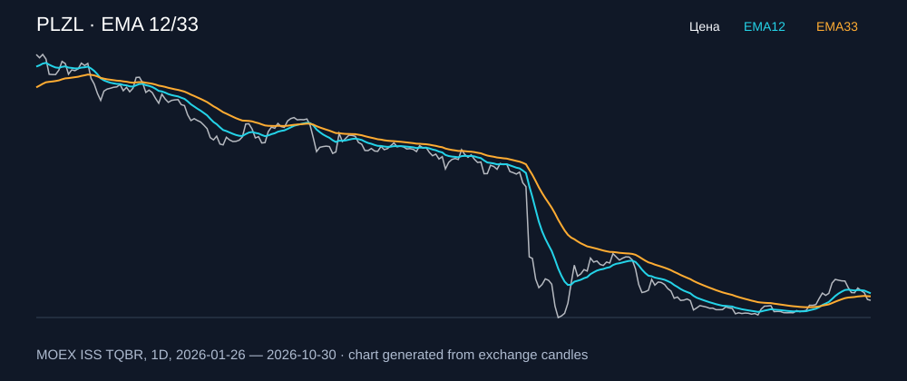

# PLZL — EMA 12/33

[Полный README тикера](../../../../../legacy-ema/12-33-cross/execute/research/tickers/PLZL/README.md) · [TradingView](https://www.tradingview.com/symbols/RUS-PLZL/)

Медианный оборот: **2069.5 млн ₽**. Источник цифр ниже: **MOEX ISS + локальный расчёт**, не TradingView.

Критерии: ≥10 закрытых сделок за полный период, ≥3 в 2025–2026 и ≥1 прибыльная поздняя сделка, положительная доходность и превышение удержания на обоих периодах, profit factor >1, просадка не глубже 30%, медианный оборот ≥50 млн ₽.

| Интервал | Режим | EMA | Закрытых сделок | Прибыльных | Доходность | Макс. просадка | Сделок 2025–26 | Доходность 2025–26 | Превышение удержания 2025–26 |
| --- | --- | --- | ---: | ---: | ---: | ---: | ---: | ---: | ---: |
| 1D | long | 12/33 | 14 | 5/14 (35.71%) | 22.37% | -7.46% | 6 | 9.79% | 16.19 п.п. |
| 1D | short | 12/33 | 15 | 5/15 (33.33%) | 2.29% | -15.25% | 6 | 11.54% | 17.94 п.п. |
| 1D | long_short | 12/33 | 29 | 10/29 (34.48%) | 25.13% | -14.2% | 12 | 22.47% | 28.86 п.п. |
| 1H | long | 12/33 | 176 | 68/176 (38.64%) | 24.96% | -6.19% | 120 | 16.52% | 22.91 п.п. |
| 1H | short | 12/33 | 176 | 55/176 (31.25%) | 17.13% | -8.86% | 119 | 18.17% | 24.57 п.п. |
| 1H | long_short | 12/33 | 352 | 123/352 (34.94%) | 46.35% | -6.55% | 239 | 37.73% | 44.13 п.п. |
| 4H | long | 12/33 | 48 | 17/48 (35.42%) | 14.83% | -9.28% | 32 | 3.09% | 9.49 п.п. |
| 4H | short | 12/33 | 48 | 13/48 (27.08%) | 8.84% | -10.57% | 32 | 14.35% | 20.75 п.п. |
| 4H | long_short | 12/33 | 96 | 30/96 (31.25%) | 25.01% | -8.9% | 64 | 17.86% | 24.25 п.п. |

Результаты `short` и `long_short` оптимистичны: плата за заём, дивидендные обязательства и доступность шорта не учтены.

График построен из свечей MOEX, это не скриншот TradingView.
