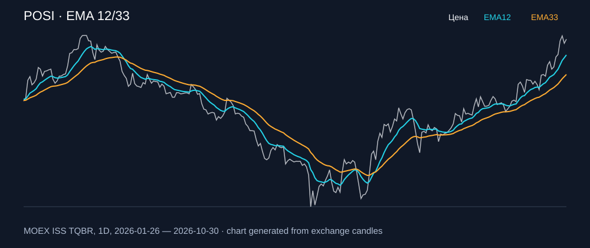

# POSI — EMA 12/33

[Полный README тикера](../../../../../legacy-ema/12-33-cross/execute/research/tickers/POSI/README.md) · [TradingView](https://www.tradingview.com/symbols/RUS-POSI/)

Медианный оборот: **374.4 млн ₽**. Источник цифр ниже: **MOEX ISS + локальный расчёт**, не TradingView.

Критерии: ≥10 закрытых сделок за полный период, ≥3 в 2025–2026 и ≥1 прибыльная поздняя сделка, положительная доходность и превышение удержания на обоих периодах, profit factor >1, просадка не глубже 30%, медианный оборот ≥50 млн ₽.

| Интервал | Режим | EMA | Закрытых сделок | Прибыльных | Доходность | Макс. просадка | Сделок 2025–26 | Доходность 2025–26 | Превышение удержания 2025–26 |
| --- | --- | --- | ---: | ---: | ---: | ---: | ---: | ---: | ---: |
| 1D | long | 12/33 | 10 | 5/10 (50.0%) | 38.47% | -8.04% | 4 | 11.53% | 21.4 п.п. |
| 1D | long_short | 12/33 | 20 | 12/20 (60.0%) | 66.25% | -12.05% | 8 | 33.8% | 43.66 п.п. |
| 1H | long | 12/33 | 186 | 53/186 (28.49%) | 0.64% | -12.68% | 133 | 2.43% | 12.29 п.п. |
| 1H | short | 12/33 | 187 | 46/187 (24.6%) | 9.27% | -8.84% | 134 | 11.23% | 21.09 п.п. |
| 1H | long_short | 12/33 | 373 | 99/373 (26.54%) | 10.02% | -8.2% | 267 | 13.92% | 23.79 п.п. |
| 4H | short | 12/33 | 54 | 16/54 (29.63%) | 10.34% | -6.6% | 42 | 10.83% | 20.7 п.п. |
| 4H | long_short | 12/33 | 107 | 25/107 (23.36%) | 11.37% | -9.66% | 83 | 13.0% | 22.86 п.п. |

Результаты `short` и `long_short` оптимистичны: плата за заём, дивидендные обязательства и доступность шорта не учтены.

График построен из свечей MOEX, это не скриншот TradingView.
