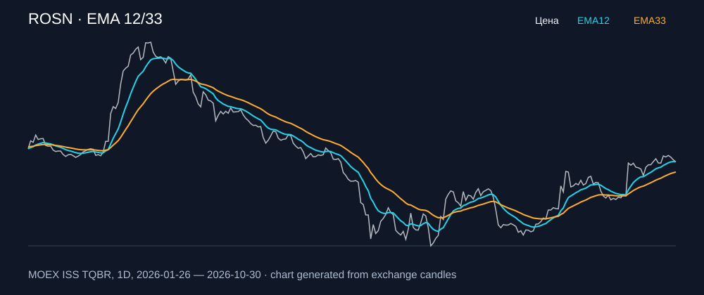

# ROSN — EMA 12/33

[Полный README тикера](../../../../../legacy-ema/12-33-cross/execute/research/tickers/ROSN/README.md) · [TradingView](https://www.tradingview.com/symbols/RUS-ROSN/)

Медианный оборот: **3612.8 млн ₽**. Источник цифр ниже: **MOEX ISS + локальный расчёт**, не TradingView.

Критерии: ≥10 закрытых сделок за полный период, ≥3 в 2025–2026 и ≥1 прибыльная поздняя сделка, положительная доходность и превышение удержания на обоих периодах, profit factor >1, просадка не глубже 30%, медианный оборот ≥50 млн ₽.

| Интервал | Режим | EMA | Закрытых сделок | Прибыльных | Доходность | Макс. просадка | Сделок 2025–26 | Доходность 2025–26 | Превышение удержания 2025–26 |
| --- | --- | --- | ---: | ---: | ---: | ---: | ---: | ---: | ---: |
| 1H | long | 12/33 | 183 | 50/183 (27.32%) | 4.08% | -7.93% | 132 | 0.46% | 9.77 п.п. |
| 1H | short | 12/33 | 183 | 55/183 (30.05%) | 11.67% | -6.03% | 132 | 8.68% | 18.0 п.п. |
| 1H | long_short | 12/33 | 366 | 105/366 (28.69%) | 16.22% | -8.55% | 264 | 9.18% | 18.5 п.п. |
| 4H | long | 12/33 | 46 | 13/46 (28.26%) | 5.57% | -7.48% | 35 | 3.12% | 12.43 п.п. |
| 4H | short | 12/33 | 46 | 22/46 (47.83%) | 13.87% | -5.27% | 36 | 9.98% | 19.3 п.п. |
| 4H | long_short | 12/33 | 92 | 35/92 (38.04%) | 20.23% | -10.21% | 71 | 13.42% | 22.73 п.п. |

Результаты `short` и `long_short` оптимистичны: плата за заём, дивидендные обязательства и доступность шорта не учтены.

График построен из свечей MOEX, это не скриншот TradingView.
