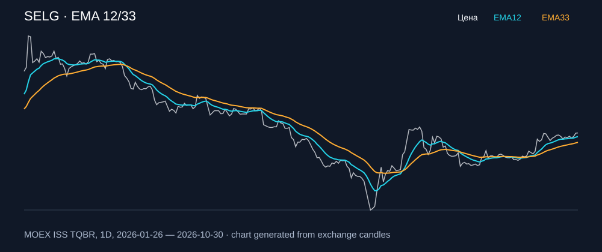

# SELG — EMA 12/33

[Полный README тикера](../../../../../legacy-ema/12-33-cross/execute/research/tickers/SELG/README.md) · [TradingView](https://www.tradingview.com/symbols/RUS-SELG/)

Медианный оборот: **150.8 млн ₽**. Источник цифр ниже: **MOEX ISS + локальный расчёт**, не TradingView.

Критерии: ≥10 закрытых сделок за полный период, ≥3 в 2025–2026 и ≥1 прибыльная поздняя сделка, положительная доходность и превышение удержания на обоих периодах, profit factor >1, просадка не глубже 30%, медианный оборот ≥50 млн ₽.

| Интервал | Режим | EMA | Закрытых сделок | Прибыльных | Доходность | Макс. просадка | Сделок 2025–26 | Доходность 2025–26 | Превышение удержания 2025–26 |
| --- | --- | --- | ---: | ---: | ---: | ---: | ---: | ---: | ---: |
| 1D | long | 12/33 | 13 | 6/13 (46.15%) | 18.61% | -8.91% | 5 | 8.81% | 8.83 п.п. |
| 1D | short | 12/33 | 13 | 7/13 (53.85%) | 15.92% | -8.22% | 5 | 6.49% | 6.51 п.п. |
| 1D | long_short | 12/33 | 26 | 13/26 (50.0%) | 37.48% | -10.79% | 10 | 15.85% | 15.87 п.п. |

Результаты `short` и `long_short` оптимистичны: плата за заём, дивидендные обязательства и доступность шорта не учтены.

График построен из свечей MOEX, это не скриншот TradingView.
