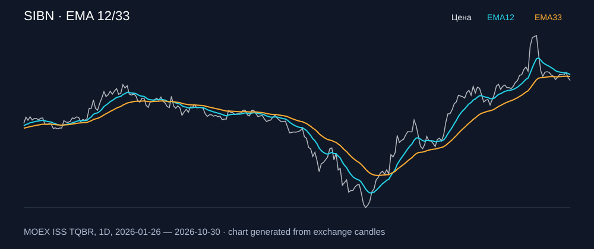

# SIBN — EMA 12/33

[Полный README тикера](../../../../../legacy-ema/12-33-cross/execute/research/tickers/SIBN/README.md) · [TradingView](https://www.tradingview.com/symbols/RUS-SIBN/)

Медианный оборот: **592.7 млн ₽**. Источник цифр ниже: **MOEX ISS + локальный расчёт**, не TradingView.

Критерии: ≥10 закрытых сделок за полный период, ≥3 в 2025–2026 и ≥1 прибыльная поздняя сделка, положительная доходность и превышение удержания на обоих периодах, profit factor >1, просадка не глубже 30%, медианный оборот ≥50 млн ₽.

| Интервал | Режим | EMA | Закрытых сделок | Прибыльных | Доходность | Макс. просадка | Сделок 2025–26 | Доходность 2025–26 | Превышение удержания 2025–26 |
| --- | --- | --- | ---: | ---: | ---: | ---: | ---: | ---: | ---: |
| 1D | long | 12/33 | 12 | 3/12 (25.0%) | 22.67% | -8.45% | 6 | 4.6% | 8.19 п.п. |
| 1D | short | 12/33 | 12 | 6/12 (50.0%) | 7.34% | -5.81% | 7 | 5.22% | 8.82 п.п. |
| 1D | long_short | 12/33 | 24 | 9/24 (37.5%) | 31.67% | -8.92% | 13 | 10.05% | 13.65 п.п. |

Результаты `short` и `long_short` оптимистичны: плата за заём, дивидендные обязательства и доступность шорта не учтены.

График построен из свечей MOEX, это не скриншот TradingView.
