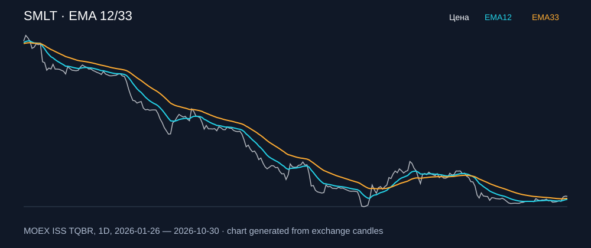

# SMLT — EMA 12/33

[Полный README тикера](../../../../../legacy-ema/12-33-cross/execute/research/tickers/SMLT/README.md) · [TradingView](https://www.tradingview.com/symbols/RUS-SMLT/)

Медианный оборот: **1722.6 млн ₽**. Источник цифр ниже: **MOEX ISS + локальный расчёт**, не TradingView.

Критерии: ≥10 закрытых сделок за полный период, ≥3 в 2025–2026 и ≥1 прибыльная поздняя сделка, положительная доходность и превышение удержания на обоих периодах, profit factor >1, просадка не глубже 30%, медианный оборот ≥50 млн ₽.

| Интервал | Режим | EMA | Закрытых сделок | Прибыльных | Доходность | Макс. просадка | Сделок 2025–26 | Доходность 2025–26 | Превышение удержания 2025–26 |
| --- | --- | --- | ---: | ---: | ---: | ---: | ---: | ---: | ---: |
| 1D | short | 12/33 | 15 | 5/15 (33.33%) | 33.15% | -10.77% | 8 | 18.65% | 37.35 п.п. |
| 1D | long_short | 12/33 | 31 | 7/31 (22.58%) | 25.12% | -17.9% | 17 | 7.34% | 26.04 п.п. |
| 1H | long | 12/33 | 168 | 42/168 (25.0%) | 7.58% | -9.92% | 113 | 15.86% | 34.56 п.п. |
| 1H | short | 12/33 | 169 | 67/169 (39.64%) | 83.48% | -7.89% | 114 | 46.12% | 64.82 п.п. |
| 1H | long_short | 12/33 | 337 | 109/337 (32.34%) | 97.48% | -10.99% | 227 | 69.3% | 88.0 п.п. |
| 4H | short | 12/33 | 47 | 23/47 (48.94%) | 62.11% | -8.91% | 37 | 30.17% | 48.87 п.п. |
| 4H | long_short | 12/33 | 94 | 35/94 (37.23%) | 56.21% | -10.54% | 73 | 24.04% | 42.74 п.п. |

Результаты `short` и `long_short` оптимистичны: плата за заём, дивидендные обязательства и доступность шорта не учтены.

График построен из свечей MOEX, это не скриншот TradingView.
