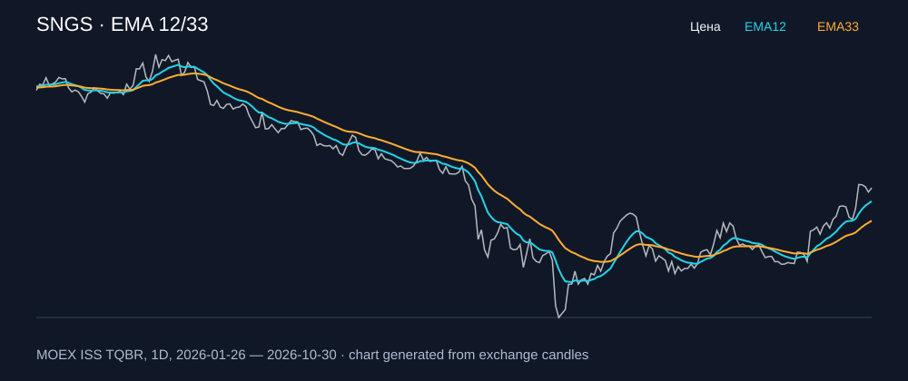

# SNGS — EMA 12/33

[Полный README тикера](../../../../../legacy-ema/12-33-cross/execute/research/tickers/SNGS/README.md) · [TradingView](https://www.tradingview.com/symbols/RUS-SNGS/)

Медианный оборот: **498.2 млн ₽**. Источник цифр ниже: **MOEX ISS + локальный расчёт**, не TradingView.

Критерии: ≥10 закрытых сделок за полный период, ≥3 в 2025–2026 и ≥1 прибыльная поздняя сделка, положительная доходность и превышение удержания на обоих периодах, profit factor >1, просадка не глубже 30%, медианный оборот ≥50 млн ₽.

| Интервал | Режим | EMA | Закрытых сделок | Прибыльных | Доходность | Макс. просадка | Сделок 2025–26 | Доходность 2025–26 | Превышение удержания 2025–26 |
| --- | --- | --- | ---: | ---: | ---: | ---: | ---: | ---: | ---: |
| 4H | short | 12/33 | 46 | 22/46 (47.83%) | 10.39% | -5.55% | 35 | 5.22% | 12.25 п.п. |
| 4H | long_short | 12/33 | 91 | 34/91 (37.36%) | 11.12% | -7.9% | 69 | 5.85% | 12.87 п.п. |

Результаты `short` и `long_short` оптимистичны: плата за заём, дивидендные обязательства и доступность шорта не учтены.

График построен из свечей MOEX, это не скриншот TradingView.
