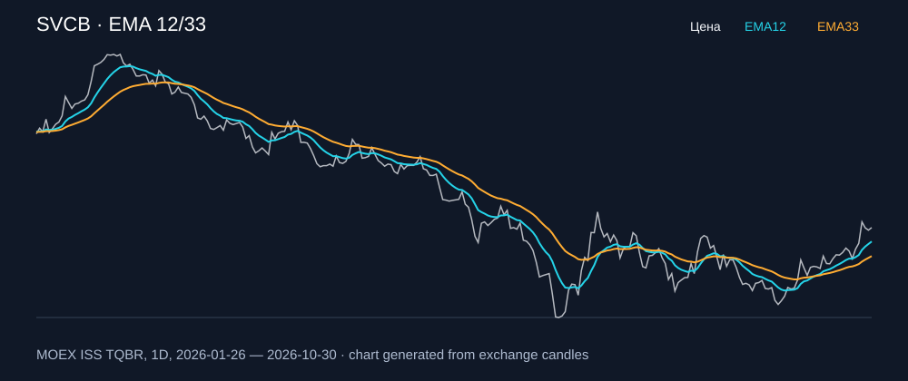

# SVCB — EMA 12/33

[Полный README тикера](../../../../../legacy-ema/12-33-cross/execute/research/tickers/SVCB/README.md) · [TradingView](https://www.tradingview.com/symbols/RUS-SVCB/)

Медианный оборот: **594.9 млн ₽**. Источник цифр ниже: **MOEX ISS + локальный расчёт**, не TradingView.

Критерии: ≥10 закрытых сделок за полный период, ≥3 в 2025–2026 и ≥1 прибыльная поздняя сделка, положительная доходность и превышение удержания на обоих периодах, profit factor >1, просадка не глубже 30%, медианный оборот ≥50 млн ₽.

| Интервал | Режим | EMA | Закрытых сделок | Прибыльных | Доходность | Макс. просадка | Сделок 2025–26 | Доходность 2025–26 | Превышение удержания 2025–26 |
| --- | --- | --- | ---: | ---: | ---: | ---: | ---: | ---: | ---: |
| 1D | short | 12/33 | 11 | 5/11 (45.45%) | 7.37% | -7.2% | 8 | 5.79% | 11.89 п.п. |
| 1D | long_short | 12/33 | 21 | 7/21 (33.33%) | 4.52% | -9.83% | 15 | 2.67% | 8.77 п.п. |
| 4H | short | 12/33 | 50 | 17/50 (34.0%) | 12.37% | -5.66% | 40 | 6.33% | 12.43 п.п. |
| 4H | long_short | 12/33 | 100 | 31/100 (31.0%) | 21.15% | -6.42% | 79 | 6.11% | 12.21 п.п. |

Результаты `short` и `long_short` оптимистичны: плата за заём, дивидендные обязательства и доступность шорта не учтены.

График построен из свечей MOEX, это не скриншот TradingView.
