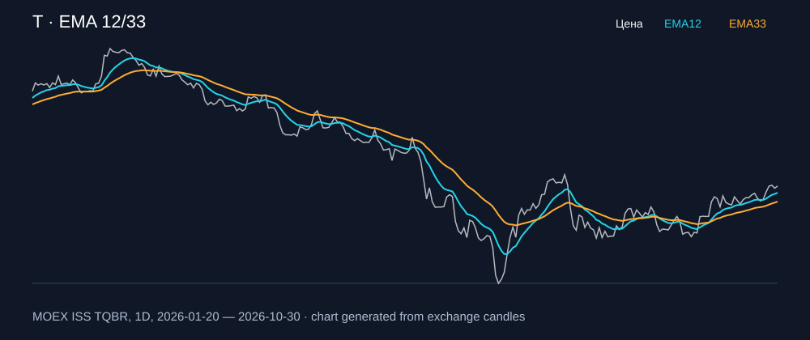

# T — EMA 12/33

[Полный README тикера](../../../../../legacy-ema/12-33-cross/execute/research/tickers/T/README.md) · [TradingView](https://www.tradingview.com/symbols/RUS-T/)

Медианный оборот: **3513.1 млн ₽**. Источник цифр ниже: **MOEX ISS + локальный расчёт**, не TradingView.

Критерии: ≥10 закрытых сделок за полный период, ≥3 в 2025–2026 и ≥1 прибыльная поздняя сделка, положительная доходность и превышение удержания на обоих периодах, profit factor >1, просадка не глубже 30%, медианный оборот ≥50 млн ₽.

| Интервал | Режим | EMA | Закрытых сделок | Прибыльных | Доходность | Макс. просадка | Сделок 2025–26 | Доходность 2025–26 | Превышение удержания 2025–26 |
| --- | --- | --- | ---: | ---: | ---: | ---: | ---: | ---: | ---: |
| 1H | long | 12/33 | 171 | 52/171 (30.41%) | 8.2% | -5.62% | 120 | 7.15% | 7.03 п.п. |
| 1H | short | 12/33 | 172 | 54/172 (31.4%) | 9.58% | -4.16% | 121 | 4.44% | 4.32 п.п. |
| 1H | long_short | 12/33 | 343 | 106/343 (30.9%) | 18.58% | -5.67% | 241 | 11.92% | 11.8 п.п. |
| 4H | long | 12/33 | 49 | 15/49 (30.61%) | 0.61% | -8.1% | 31 | 4.79% | 4.67 п.п. |
| 4H | short | 12/33 | 50 | 17/50 (34.0%) | 2.36% | -4.85% | 32 | 5.0% | 4.88 п.п. |
| 4H | long_short | 12/33 | 99 | 32/99 (32.32%) | 2.98% | -10.97% | 63 | 10.03% | 9.91 п.п. |

Результаты `short` и `long_short` оптимистичны: плата за заём, дивидендные обязательства и доступность шорта не учтены.

График построен из свечей MOEX, это не скриншот TradingView.
