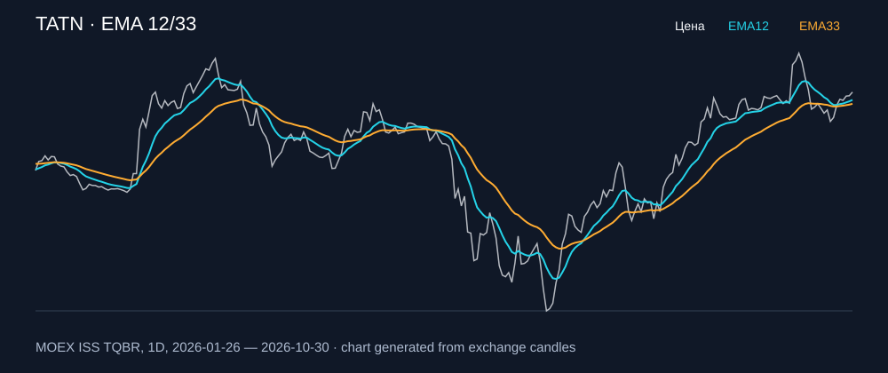

# TATN — EMA 12/33

[Полный README тикера](../../../../../legacy-ema/12-33-cross/execute/research/tickers/TATN/README.md) · [TradingView](https://www.tradingview.com/symbols/RUS-TATN/)

Медианный оборот: **1280.4 млн ₽**. Источник цифр ниже: **MOEX ISS + локальный расчёт**, не TradingView.

Критерии: ≥10 закрытых сделок за полный период, ≥3 в 2025–2026 и ≥1 прибыльная поздняя сделка, положительная доходность и превышение удержания на обоих периодах, profit factor >1, просадка не глубже 30%, медианный оборот ≥50 млн ₽.

| Интервал | Режим | EMA | Закрытых сделок | Прибыльных | Доходность | Макс. просадка | Сделок 2025–26 | Доходность 2025–26 | Превышение удержания 2025–26 |
| --- | --- | --- | ---: | ---: | ---: | ---: | ---: | ---: | ---: |
| 1D | long | 12/33 | 13 | 4/13 (30.77%) | 22.92% | -7.65% | 5 | 2.29% | 4.0 п.п. |
| 1D | long_short | 12/33 | 26 | 10/26 (38.46%) | 25.65% | -10.55% | 11 | 5.35% | 7.05 п.п. |
| 1H | long | 12/33 | 173 | 54/173 (31.21%) | 6.16% | -7.64% | 119 | 3.46% | 5.17 п.п. |
| 1H | short | 12/33 | 174 | 52/174 (29.89%) | 5.56% | -5.68% | 120 | 1.56% | 3.26 п.п. |
| 1H | long_short | 12/33 | 347 | 106/347 (30.55%) | 12.08% | -8.04% | 239 | 5.08% | 6.79 п.п. |
| 4H | long | 12/33 | 49 | 17/49 (34.69%) | 5.82% | -8.63% | 36 | 2.12% | 3.83 п.п. |
| 4H | short | 12/33 | 49 | 22/49 (44.9%) | 5.52% | -6.66% | 37 | 1.18% | 2.88 п.п. |
| 4H | long_short | 12/33 | 98 | 39/98 (39.8%) | 11.64% | -11.46% | 73 | 3.33% | 5.04 п.п. |

Результаты `short` и `long_short` оптимистичны: плата за заём, дивидендные обязательства и доступность шорта не учтены.

График построен из свечей MOEX, это не скриншот TradingView.
