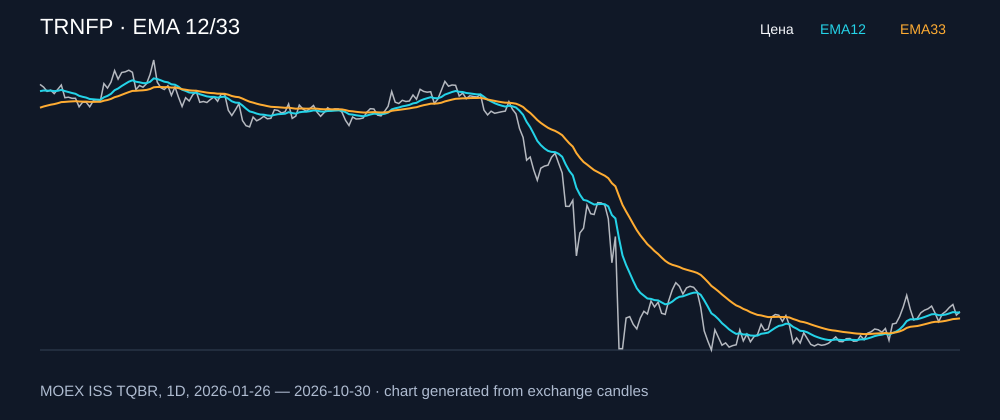

# TRNFP — EMA 12/33

[Полный README тикера](../../../../../legacy-ema/12-33-cross/execute/research/tickers/TRNFP/README.md) · [TradingView](https://www.tradingview.com/symbols/RUS-TRNFP/)

Медианный оборот: **557.3 млн ₽**. Источник цифр ниже: **MOEX ISS + локальный расчёт**, не TradingView.

Критерии: ≥10 закрытых сделок за полный период, ≥3 в 2025–2026 и ≥1 прибыльная поздняя сделка, положительная доходность и превышение удержания на обоих периодах, profit factor >1, просадка не глубже 30%, медианный оборот ≥50 млн ₽.

| Интервал | Режим | EMA | Закрытых сделок | Прибыльных | Доходность | Макс. просадка | Сделок 2025–26 | Доходность 2025–26 | Превышение удержания 2025–26 |
| --- | --- | --- | ---: | ---: | ---: | ---: | ---: | ---: | ---: |
| 1D | long | 12/33 | 15 | 6/15 (40.0%) | 7.88% | -7.52% | 7 | 0.56% | 3.74 п.п. |
| 1D | short | 12/33 | 15 | 7/15 (46.67%) | 7.83% | -9.89% | 7 | 2.67% | 5.85 п.п. |
| 1D | long_short | 12/33 | 30 | 13/30 (43.33%) | 16.35% | -9.84% | 14 | 3.27% | 6.45 п.п. |

Результаты `short` и `long_short` оптимистичны: плата за заём, дивидендные обязательства и доступность шорта не учтены.

График построен из свечей MOEX, это не скриншот TradingView.
