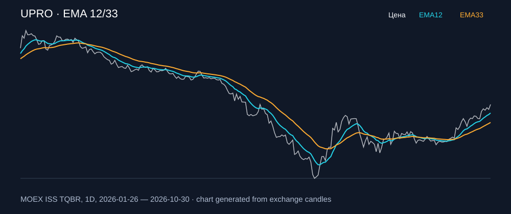

# UPRO — EMA 12/33

[Полный README тикера](../../../../../legacy-ema/12-33-cross/execute/research/tickers/UPRO/README.md) · [TradingView](https://www.tradingview.com/symbols/RUS-UPRO/)

Медианный оборот: **192.4 млн ₽**. Источник цифр ниже: **MOEX ISS + локальный расчёт**, не TradingView.

Критерии: ≥10 закрытых сделок за полный период, ≥3 в 2025–2026 и ≥1 прибыльная поздняя сделка, положительная доходность и превышение удержания на обоих периодах, profit factor >1, просадка не глубже 30%, медианный оборот ≥50 млн ₽.

| Интервал | Режим | EMA | Закрытых сделок | Прибыльных | Доходность | Макс. просадка | Сделок 2025–26 | Доходность 2025–26 | Превышение удержания 2025–26 |
| --- | --- | --- | ---: | ---: | ---: | ---: | ---: | ---: | ---: |
| 1D | short | 12/33 | 15 | 5/15 (33.33%) | 1.81% | -10.42% | 6 | 8.85% | 17.43 п.п. |
| 1D | long_short | 12/33 | 30 | 10/30 (33.33%) | 3.78% | -13.1% | 11 | 7.66% | 16.25 п.п. |
| 1H | short | 12/33 | 206 | 61/206 (29.61%) | 7.02% | -7.93% | 149 | 5.24% | 13.83 п.п. |
| 1H | long_short | 12/33 | 411 | 116/411 (28.22%) | 4.81% | -11.26% | 297 | 4.49% | 13.08 п.п. |
| 4H | long | 12/33 | 45 | 9/45 (20.0%) | 9.99% | -10.7% | 31 | 1.97% | 10.56 п.п. |
| 4H | short | 12/33 | 46 | 17/46 (36.96%) | 19.55% | -5.72% | 32 | 17.99% | 26.57 п.п. |
| 4H | long_short | 12/33 | 91 | 26/91 (28.57%) | 31.5% | -8.23% | 63 | 20.32% | 28.91 п.п. |

Результаты `short` и `long_short` оптимистичны: плата за заём, дивидендные обязательства и доступность шорта не учтены.

График построен из свечей MOEX, это не скриншот TradingView.
