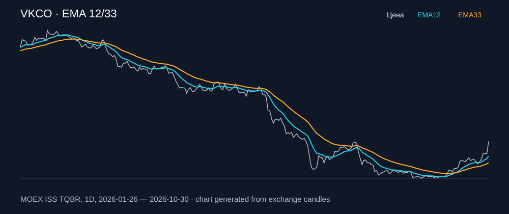

# VKCO — EMA 12/33

[Полный README тикера](../../../../../legacy-ema/12-33-cross/execute/research/tickers/VKCO/README.md) · [TradingView](https://www.tradingview.com/symbols/RUS-VKCO/)

Медианный оборот: **853.2 млн ₽**. Источник цифр ниже: **MOEX ISS + локальный расчёт**, не TradingView.

Критерии: ≥10 закрытых сделок за полный период, ≥3 в 2025–2026 и ≥1 прибыльная поздняя сделка, положительная доходность и превышение удержания на обоих периодах, profit factor >1, просадка не глубже 30%, медианный оборот ≥50 млн ₽.

| Интервал | Режим | EMA | Закрытых сделок | Прибыльных | Доходность | Макс. просадка | Сделок 2025–26 | Доходность 2025–26 | Превышение удержания 2025–26 |
| --- | --- | --- | ---: | ---: | ---: | ---: | ---: | ---: | ---: |
| 1D | long | 12/33 | 13 | 5/13 (38.46%) | 11.49% | -14.83% | 4 | 13.27% | 25.34 п.п. |
| 1D | short | 12/33 | 13 | 6/13 (46.15%) | 17.94% | -13.77% | 5 | 19.04% | 31.11 п.п. |
| 1D | long_short | 12/33 | 26 | 11/26 (42.31%) | 31.53% | -25.32% | 9 | 34.83% | 46.91 п.п. |
| 1H | short | 12/33 | 181 | 62/181 (34.25%) | 27.79% | -8.21% | 138 | 6.83% | 18.9 п.п. |
| 1H | long_short | 12/33 | 361 | 115/361 (31.86%) | 24.78% | -12.03% | 275 | 3.14% | 15.22 п.п. |
| 4H | short | 12/33 | 47 | 19/47 (40.43%) | 33.81% | -5.47% | 37 | 18.17% | 30.25 п.п. |
| 4H | long_short | 12/33 | 93 | 33/93 (35.48%) | 37.52% | -9.2% | 73 | 24.6% | 36.67 п.п. |

Результаты `short` и `long_short` оптимистичны: плата за заём, дивидендные обязательства и доступность шорта не учтены.

График построен из свечей MOEX, это не скриншот TradingView.
