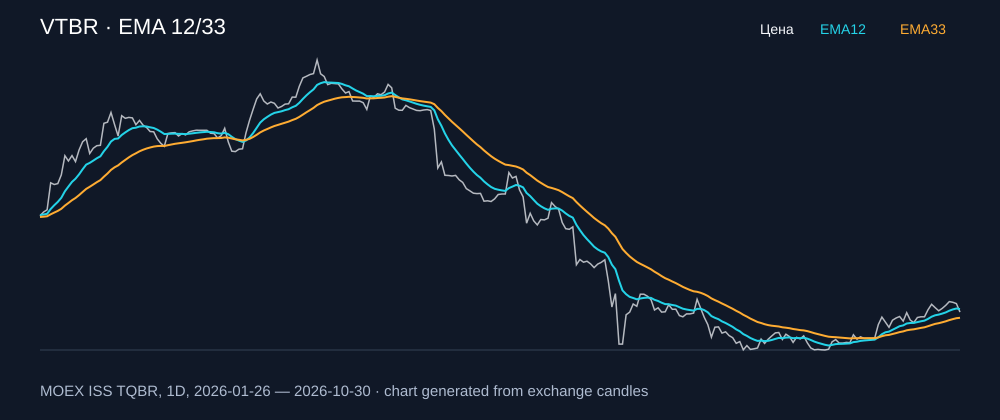

# VTBR — EMA 12/33

[Полный README тикера](../../../../../legacy-ema/12-33-cross/execute/research/tickers/VTBR/README.md) · [TradingView](https://www.tradingview.com/symbols/RUS-VTBR/)

Медианный оборот: **2461.1 млн ₽**. Источник цифр ниже: **MOEX ISS + локальный расчёт**, не TradingView.

Критерии: ≥10 закрытых сделок за полный период, ≥3 в 2025–2026 и ≥1 прибыльная поздняя сделка, положительная доходность и превышение удержания на обоих периодах, profit factor >1, просадка не глубже 30%, медианный оборот ≥50 млн ₽.

| Интервал | Режим | EMA | Закрытых сделок | Прибыльных | Доходность | Макс. просадка | Сделок 2025–26 | Доходность 2025–26 | Превышение удержания 2025–26 |
| --- | --- | --- | ---: | ---: | ---: | ---: | ---: | ---: | ---: |
| 1D | long | 12/33 | 15 | 6/15 (40.0%) | 5.77% | -9.18% | 5 | 6.52% | 14.05 п.п. |
| 1D | short | 12/33 | 15 | 4/15 (26.67%) | 11.05% | -10.7% | 6 | 11.78% | 19.32 п.п. |
| 1D | long_short | 12/33 | 30 | 10/30 (33.33%) | 17.48% | -15.03% | 11 | 19.1% | 26.64 п.п. |
| 1H | long | 12/33 | 178 | 55/178 (30.9%) | 5.04% | -6.42% | 127 | 6.64% | 14.17 п.п. |
| 1H | short | 12/33 | 178 | 58/178 (32.58%) | 19.77% | -8.3% | 127 | 10.36% | 17.9 п.п. |
| 1H | long_short | 12/33 | 356 | 113/356 (31.74%) | 25.8% | -9.61% | 254 | 17.7% | 25.23 п.п. |
| 4H | long | 12/33 | 46 | 11/46 (23.91%) | 3.21% | -8.46% | 33 | 4.2% | 11.73 п.п. |
| 4H | short | 12/33 | 47 | 17/47 (36.17%) | 20.06% | -6.04% | 34 | 11.19% | 18.72 п.п. |
| 4H | long_short | 12/33 | 93 | 28/93 (30.11%) | 23.93% | -10.59% | 67 | 15.86% | 23.39 п.п. |

Результаты `short` и `long_short` оптимистичны: плата за заём, дивидендные обязательства и доступность шорта не учтены.

График построен из свечей MOEX, это не скриншот TradingView.
