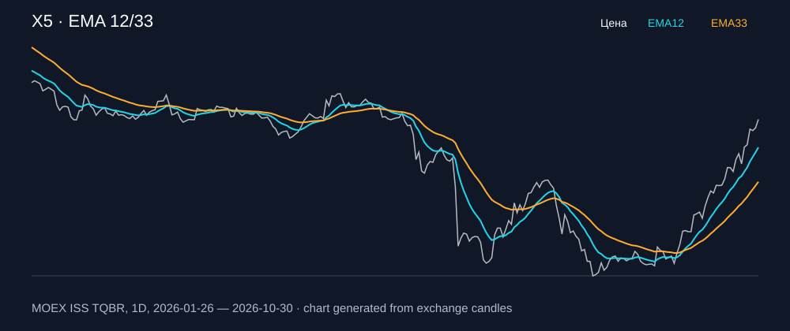

# X5 — EMA 12/33

[Полный README тикера](../../../../../legacy-ema/12-33-cross/execute/research/tickers/X5/README.md) · [TradingView](https://www.tradingview.com/symbols/RUS-X5/)

Медианный оборот: **1043.0 млн ₽**. Источник цифр ниже: **MOEX ISS + локальный расчёт**, не TradingView.

Критерии: ≥10 закрытых сделок за полный период, ≥3 в 2025–2026 и ≥1 прибыльная поздняя сделка, положительная доходность и превышение удержания на обоих периодах, profit factor >1, просадка не глубже 30%, медианный оборот ≥50 млн ₽.

| Интервал | Режим | EMA | Закрытых сделок | Прибыльных | Доходность | Макс. просадка | Сделок 2025–26 | Доходность 2025–26 | Превышение удержания 2025–26 |
| --- | --- | --- | ---: | ---: | ---: | ---: | ---: | ---: | ---: |
| 1H | long | 12/33 | 128 | 38/128 (29.69%) | 3.22% | -6.88% | 128 | 3.22% | 7.64 п.п. |
| 1H | short | 12/33 | 129 | 36/129 (27.91%) | 5.8% | -4.28% | 129 | 5.8% | 10.22 п.п. |
| 1H | long_short | 12/33 | 257 | 74/257 (28.79%) | 9.19% | -6.1% | 257 | 9.19% | 13.62 п.п. |
| 4H | long | 12/33 | 28 | 11/28 (39.29%) | 8.45% | -4.06% | 28 | 8.45% | 12.88 п.п. |
| 4H | short | 12/33 | 29 | 12/29 (41.38%) | 14.69% | -3.77% | 29 | 14.69% | 19.12 п.п. |
| 4H | long_short | 12/33 | 57 | 23/57 (40.35%) | 24.35% | -4.4% | 57 | 24.35% | 28.78 п.п. |

Результаты `short` и `long_short` оптимистичны: плата за заём, дивидендные обязательства и доступность шорта не учтены.

График построен из свечей MOEX, это не скриншот TradingView.
